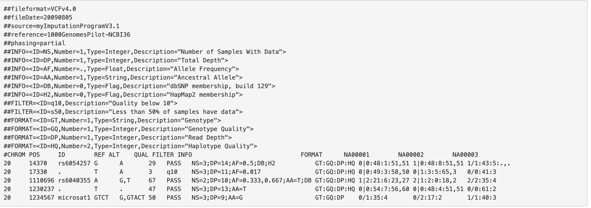
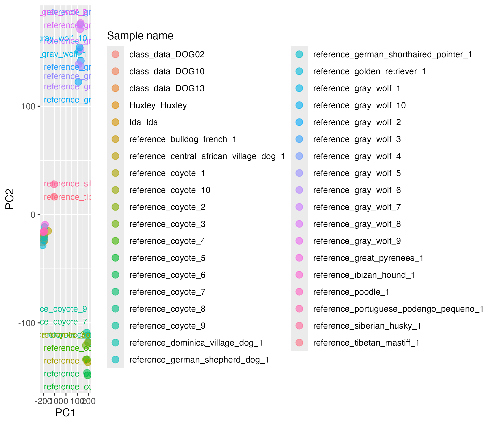
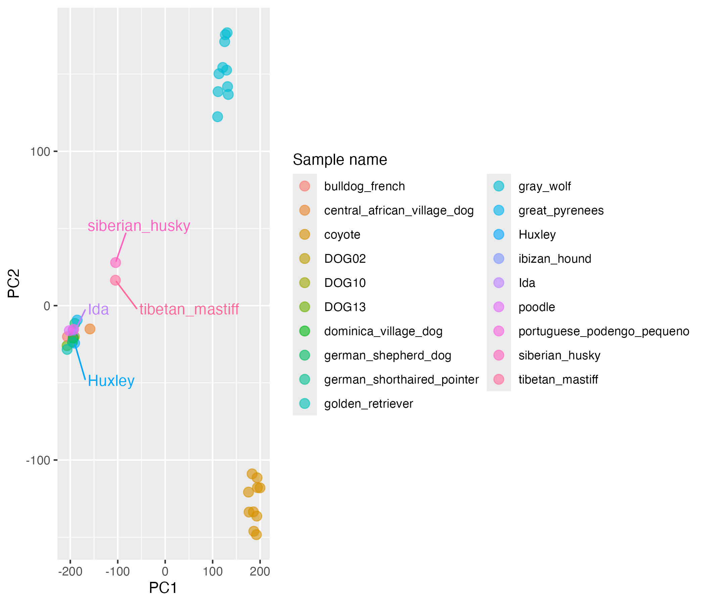

# AncestrySnpsToPcaDemo

## Inroduction
Many people are interested in the breed origins of their dogs. One will often hear people say things along the lines of: "My dog is definitely part dingo", or "I'm pretty sure Rex is a wolf hybrid", or "Fritz is a Carolina dog". Given preternatural curiosity and a non-trivial chunk of money, one can now get a better handle on the genetic ancestry of your canine pet by submitting a DNA sample via [Embark](embarkvet.com/). Embark uses a genotyping array designed for dogs, which generates genotypes at hundreds of thousands of variable sites in the dog genome. The company then performs ancestry inference, comparing your dog's genotypes against those for a large panel of bered dogs, from which the percentages of ancestry from various breeds in your dog can be estimated.

This repository demonsrates how one would analyze the data yourself, if say you and a bunch of friends got back results for your dogs and wanted to compare them. The goal of this demo is to wrangle the Embark data so that you can:

* Merge your dog's (or all of the class') Embark data with Embark-provided reference samples
  * these include wolf, coyote, and select dog breed samples (and a few of the class dogs)
* Convert to variant call format (vcf)
* Do some basic analyses
  * PCA on genootypes to see where samples fall relative to one another
  * Look at allele frequency differences bewteen dogs and wolves near genes of interest
  * Calculate heterozygosity to compare dog and wild canid samples
    * Which do you expect to have higher heterozygosity?

## Data analysis: your dogs
### PLINK files: 1st steps
PLINK is a software package for manipulating genotype array data. Unsurprisingly, PLINK also refes to a particular file format, or more specifically, a set of files that store genotypes that can be used with PLINK and other tools that can take PLINK format files as input. There are text-reader readible PLINK files that have *ped*, *fam*, and *map* file extensions--typically, each genotyped sample has one of each of these files. There are are also binary versions ("bim and *bed). As is typicaly in bioinformatics, the same prefix can be used for different software and different data analysis contexts, e.g. "bed" files also refer to flat text files that represent genomc intervals. If you decide to stay in biology and as a result, do a bit of data crunching, you will get used to this! Or, you won't and may wind up being the owner of a vegan bakery instead.

### What Embark provides to you
Embark uses a subset of the Canine HD genotyping chip single nucleotide polymorphisms (SNPs), for a total of 82,434 polymorphic genomic positions.
Embark provides two files for your dog genotypes:
* a file ending with tfam. which is a "transposed" version of the fam file that has the following columns:
  * Family ID
  * Sample ID
  * Father ID
  * Mother ID
  * Sex (1=male, 2=female, 0=unknown)
  * Phenotype (1/2 for case/control, 0 or -9 for unknown)


* a file ending with tped that is a transposed ped file, that contains the genotypes, stored in the following columns:
  * chromosome
  * variant ID
  * genetic distance
  * base position
  * sample1-allele1
  * sample1-allele2

The reported genotype data are "biallelic", meaning there are two possible nucleotides. While for your Embark data there are only genotypes for your dog, it is possible to have a tped file for multiple samples, such that there would be additional columns, e.g. sample2-alelle1, sample2-allele2, etc. If this were the case, the *tfam file would have one row for each sample in the tped file. The important thing is that the data structure of the two files are consistent so you know which genotypes belong to which dog.


I submitted my (male) dog Huxley's sample and his tfam file looks like this:

```bash
WG0714125-DNA_D06_31250960227040 WG0714125-DNA_D06_31250960227040 0 0 1 -9
```

and the first few lines of his tped file look like this:

```bash
1 BICF2P98519 0 486173 A A 
1 BICF2G630707957 0 511277 A A
1 BICF2G630707977 0 602567 G G
```

Notice that there is no value provided for the genetic distance field (0 means unknown). Genetic distance information comes into play when you have a genetic map that quantifies distance between SNPs adjusted for linkage, as some analyses can make use of this information. So, the first 3 genotypes are on chromosome 1 at positions 486173, 511277, and 602567, with genotypes of A/A, A/A, and G/G respectively. Note that Huxley is monomorphic at these positions.


The family id and sample id are internal Embark reference numbers we don't care about. I can open the file up with a text editor and change the sample id field.

### What Embark provided to the class
Embark was nice enough to provide a merged PLINK file with a few reference wild canids (wolf and coyote), a few reference dog breed samples, and a few of the class dogs. If one of the class dogs is yours, you can follow along, or we can help you remove your dog data so you can practice re-adding it! Below, we will be merging additional class dogs to the data set.

### Counting the number of chromosomes
Annoyingly, genotype arrays can have a number of chromosomes, or have chromosome names that the PLINK software does not like. One can easily write *tped (or ped) , tfam (or fam) and *map files without every opening PLINK. But try and get PLINK to read your files, and, the headaches will begin. So, what we do is, first count the number of chromosomes. Because all of our example dog files from Embark have the same structure, we'll use the genotypes from Huxley.

```bash
awk '{print $1}' huxley.tped |awk '!a[$0]++' |wc -l > number_chromosomes.txt
```

This is just a command line parsing of the tped file (which contains the chromosome names of each genotyped site in the genotype array, and counts the unique values. If you open number_chromosomes.txt, it will tell you there are 42 chromosomes in the dog genome. The version of the genome is CanFam3.1 and there are **NOT** 42 autosomes in that genome. There are 38, but Embark data also include the following:

* 39 = X chromosome
* 40 = Y chromosome
* 41 = the "pseudoautosomal region", a segment of the X chromosome that recombines with the Y chromosome; sex chromosomes typically don't recombine (like autosomes), hence why it is called "pseudo-autosomal".
* 42 = the mitochondrial chromosome
 

### Create binary version of plink files
For a number of downstream tasks, it is convenient to covert the genotypes to binary PLINK format. All we do here is, in the shell, create an array called samples, add sample names to it, then use PLINK to stick, one by name, the sample names in a search for the tped and tfam files and thenm output binary versions. The important thing here is that we explcitly set the number of chromosoems to 82 and use the *--allow-extra-chr* switch to tell PLINK not to comlain about the weird number of chromosomes.

```bash
samples=()
for f in *.tped; do samples+=("${f%.tped}");done
for i in $samples; do \
    plink  --tped ${i}.tped --tfam ${i}.tfam \
    --make-bed --chr-set 42  --allow-extra-chr --out ${i}; \
done
```

### Create a list of dog sample binary PLINK files 
Why do we need to do this? Becaue in order to merge the individual sample PLINK files into one that contains the genotypes of all of the Embark dogs, we need to supply a file that lists these files.

If you change the names of your dog's files to be your dog's name (i.e. change the values for the first two columns of the fam file to Huxley) you would create a merge file like this:

```bash
rm merge_list.txt
for i in huxley ida;do \
    awk -v val="$i" 'BEGIN { print val".bed "val".bim "val".fam" }' \
    >> merge_list.txt; \
done
```

merge_list.txt would look like this:

```bash
huxley.bed huxley.bim huxley.fam
ida.bed ida.bim ida.fam
```

#### Merge dog binaries into multi-sample PLINK files
Once again, we need to specify arguments so that PLINK doesn't complain about the non-standard number of chromosomes, merging all the files corresponding to samples in merge_list.txt to those for Huxley:

```bash 
plink --bfile embark_idahux_removed/embark_refpanel_classsubset \
  --allow-extra-chr \
  --chr-set 42 \
  --make-bed \
  --merge-list merge_list.txt \
  --out refpanel_plusHuxleyandIda
``` 

This produces a merged file set in which:
* the fam file says what the samples are in genotypes (bed) file, and the order they are in
* the bim file contains the alleles (like the tped files we looked at above)
* the bed file is a binary-compressed file that contains the coding of how the observed alleles at a particular genomic position (per the bim file) appear as genotypes for the samples


*NOTE:* Embark had added Huxley and Ida to the data they sent us, but for the purposes of the demo I removed them. That is why the files are in the **embark_idahux_removed** directory.
*ALSO NOTE:* There is some weirdness in:
 * how plink handles the merge, and
 * how insertion/deletion polymorphisms are encoded in the Embark files
 * both create issues for downstream analysis which we will describe and fix below!


#### Convert merged dog files to vcf format
[vcf](https://gatk.broadinstitute.org/hc/en-us/articles/360035531692-VCF-Variant-Call-Format) format is the standard format for representing genotypes calculated using genome sequencing data, whether that be whole-genome sequencing or some form of "reduced representation" , such as when sequencing is done for targed regions of a genome, e.g. protein-coding genes. It contains a number of header fields that are "commented out" with "#" characters, that typically describe the chromosomes names in the file, and what various codes mean. The data part of the file describes which variants are observed and in which samples at a given genomic position, e.g.:





A few things to notice about vcf format. First, each row contains a REF and and an ALT allele. The REF allele is, not surprisingly the reference allele. For genotyping based off of aligning sequencing reads to a reference genome, the REF allele is the nucleotide observed at that position in the genome, which is typically represented in a haploid form, i.e. there is only one base. Second, the genotypes are reprsented by number combinations, with 0 denoting the REF allele and increasing integers referencing ALT alleles, which are listed in the ALT fields. It is entirely possible to have more than one alternative allele. So, if your REF allele is A, you have two alternative alleles, C and G, and a set of samples have the genotypes A/A,A/C, and A/G, they would be represented in the vcf file as 0/0, 0/1, and 1/2. If no genotype was called for a sample at a particular site, it will be represented as ./..

Anyway ... we can use PLINK to convert the merged dog files to vcf format. But we have to do so in a way that accounts for some weirdness in the Embark data. My first pass at converting to vcf yielded some warnings, which are due to lines like this:

```bash
1	BICF2S23413543	0	77788182	0	A
2	BICF2G630675117	0	10765467	0	G
1	chr1_13260261	6.62444	13260261	I	D
1	chr1_31267439	25.5556	31267439	I	D
```


The columns of the bim file are the same as the tped file. The first two lines indicate the first allele (see column 5) is unknown. The last two lines appear to be insertion/deletion polymorphisms, or something else? But they do not conform to the standard format for PLINK files, nor are they appropriate for vcf files--downstream tools expect certain values in certain columns and these are not found in the universe of acceptable things!


So ... how did this happen?? In the original files supplied by Embark (tped and tfam), my dogs are homozygous for A:

```bash
1 BICF2S23413543 0 77788182 A A 
```

BUT ... the bim files look like this:

```bash
1	BICF2S23413543	0	77788182	0	A
``` 
 
So, the file conversion to bim/bam messed with the allele coding. Welcome to bioinformatics. There are only a small number of insertion/deletion polymorphisms and since we don't have their nucleotide sequence, it is best to remove them. Similarly, we can fix the bim files, such that, when allele 2 is an actual nucleotide and allele 1 is 0, we can replace the 0 with the allele 2 nucleotide. The bed file references these columns in composing the genotypes so when we do this fix, we will be able to ouptut proper genotypes in vcf format (below).

We can use a simply python script to recode allele2 zeroes as the same as allele1. If we are in a directory called data and the scripts/ directory lives just outside of the data directory, then do this:

```bash
python ../scripts/fix_bim_alleles.py --input refpanel_plusHuxleyandIda.bim --output fixed_refpanel_plusHuxleyandIda.bim
```

Then we can just replace the original bim with the fixed one:

```bash
mv fixed_refpanel_plusHuxleyandIda.bim refpanel_plusHuxleyandIda.bim
```


We have one more problem ... that being the weird I/D coded sites. To remove these, we make a list of sites to remove:

```bash
awk '$5=="I" || $5=="D" || $6=="I" || $6=="D"{print $2}' refpanel_plusHuxleyandIda.bim > indels_to_remove.txt
```

if we look at indels_to_remove.txt, we see it contains IDs for sites we want to exclude:
```head indels_to_remove.txt

chr1_13260261
chr1_18279197
chr1_30738967
chr1_31267439
chr1_80378956
chr1_105488957
chr2_14878403
chr2_23177124
chr2_58778583
chr2_69490724

```


Then we feed this list to PLINK:

```bash
plink --bfile refpanel_plusHuxleyandIda \
  --allow-extra-chr \
  --chr-set 42 \
  --exclude indels_to_remove.txt \
  --make-bed \
  --out no_indels_fixed_refpanel_plusHuxleyandIda
```

How many indels did we remove? Let's get line counts for the before and after bim files:

```bash
wc -l *refpanel_plusHuxleyandIda.bim
```
From those results, we see that we removed 127 I/D sites


Now, let's convert our merged bim/bed file to vcf using PLINK:

```bash
plink \
  --bfile no_indels_fixed_refpanel_plusHuxleyandIda  \
  --allow-extra-chr \
  --chr-set 42 \
  --recode vcf bgz \
  --out cleanedSNPs_refpanel_plusHuxleyandIda
```

What does `recode vcf bgz` do? recode tells PLINK that you want to output a different kind of data, vcf tells it to make a vcf file, and bgz tells PLINK to compress it using a tool called *bgzip*. *bgzip is part of [htslib](https://www.htslib.org/doc/bgzip.html), and it allows for "random access" of different genomic intervals with tools designed to handle bgzip-compressed files. In fact we will such a tool right now, called [bcftools](https://samtools.github.io/bcftools/bcftools.html), which is useful for doing all sorts of filtering, manipulation, and information extraction from vcf files. Next, we are going to remove a subset of the chromosomes that aren't useful for our downstream analyses ...


#### Removing ambiguously named chromosomes
For SNP calling, we don't want to use sites for which, for some samples, there are not two chromosome copies, e.g. males don't have two X chromosomes, and females, and the mitochondrial chromosome is haploid. Remember that chr 39-42 correspond to X, Y, pseudoautomsomal region of X and mtDNA. We want to exclude these before we do any analysis

```bash
bcftools view --targets ^39,40,41,42 cleanedSNPs_refpanel_plusHuxleyandIda.vcf.gz \
         -O z -o chrfiltered_cleanedSNPs_refpanel_plusHuxleyandIda.vcf.gz
bcftools index chrfiltered_cleanedSNPs_refpanel_plusHuxleyandIda.vcf.gz
```

* `targets ^39,40,41,42` tells bcftools to exlude SNPS on those chromosomes, the `^` means "not". If you remove it then you would only retain SNPs on those chromosomes
* as you might guess, you don't need to put a space between `-O` and `z` (we didn't in the last command), it's up to you which you think is more readable ... but .. in a long command line, the spaces can help you track down mistakes


### visualizing genetic structure among your dogs: PCA
Principal components analysis (PCA) has a long history of use in quantifying and visualizing population structure. There has been much debate over what the observed patterns mean, and what underlying evolutionary processes produce them. Needless to say, PCA can be a reasonable good first peek.

I typically use [R](https://www.r-project.org/) for making figure, as well as doing a bunch of data crunching when it is enabled by built-in R packages. To make a PCA, you can do something like this, assuming you are somewhat familiar with R and know how to install packages.


#### Install necessary R packages

```bash
cran_packages <- c(
  "vcfR",
  "adegenet",
  "ggrepel",
  "tidyverse"
)

# Identify packages that are not already installed
missing_packages <- cran_packages[
  !vapply(cran_packages, requireNamespace, logical(1), quietly = TRUE)
]

# Install only missing packages
if (length(missing_packages) > 0) {
  install.packages(
    missing_packages,
    repos = "https://cloud.r-project.org",
    dependencies = TRUE
  )
}

library(vcfR)
library(adegenet)
library(tidyverse)
library(ggrepel)
```

#### set your working directory
Obviously, change the stuff in quotes to reflect where your data are.

```bash
setwd("/Users/adamfreedman/workspace/AncestrySnpsToPcaDemo/data")
```

#### First pass at PCA

```bash
## dogs only pca
classdata_vcf <- read.vcfR("chrfiltered_cleanedSNPs_refpanel_plusHuxleyandIda.vcf.gz")
classdata_adegenet <- vcfR2genind(classdata_vcf)
# replace missing values based upon mean allele frequency
classdata_impute <- scaleGen(classdata_adegenet, NA.method = "mean")  
pca_result <- prcomp(classdata_impute, center = TRUE, scale. = FALSE)
pca_tibble <- as_tibble(pca_result$x) %>%
  mutate(sample_name=row.names(pca_result$x))

pca_plot <- pca_tibble %>% ggplot(aes(x=PC1,y=PC2,color=sample_name,label=sample_name)) +
  geom_point(size=3,alpha=0.6) +
  xlab("PC1") +
  ylab("PC2") +
  geom_text_repel(aes(label=sample_name),size=3,show.legend = FALSE) +
  guides(color = guide_legend(title = "Sample name"))
```

Which produces this:



This...looks...terrible. The legend has taken up all of the space, and honestly there is a lot of extra info in the sample labels, for example:

* from the PLINK files, names are duplicated (because we set the 1st 2 column names to our dog names)
* there are prefixes such as "reference" that we don't care about and sample numbers we also don't care about.

We can do a little R function magic to create a new "group" variable to label and color points by, and only use labels for our samples, and others of interest:


#### clean up labels

```bash
normalize_sample_name <- function(x) {
  x <- str_remove(
    x,
    regex("^reference_", ignore_case = TRUE)
  )
  
  x <- str_remove(
    x,
    regex("^class_data_", ignore_case = TRUE)
  )
  
  x <- str_remove(x, "_[0-9]+$")  # tibetan_mastiff_1 -> tibetan_mastiff
  x <- str_replace_all(x, "-", "_")
  
  # Collapse names like Ida_ida or Huxley_Huxley
  parts <- str_split(x, "_", simplify = FALSE)
  
  vapply(parts, function(p) {
    if (length(p) %% 2 == 0) {
      midpoint <- length(p) / 2
      
      left <- paste(p[seq_len(midpoint)], collapse = "_")
      right <- paste(
        p[(midpoint + 1):length(p)],
        collapse = "_"
      )
      
      if (str_to_lower(left) == str_to_lower(right)) {
        return(left)
      }
    }
    
    paste(p, collapse = "_")
  }, character(1))
}

#### use function to update pca output

```bash
pca_tibble <- pca_tibble %>%
  mutate(
    sample_id = sample_name,  # preserve original ID
    group = normalize_sample_name(sample_id)
  )
```

#### tweak labels and plot PCA
We want to only plot a few labels, by specifying a vector of them, and excluding all others so things don't get too crowded

```bash
groups_to_label <- c("tibetan_mastiff","siberian_husky","Huxley","Ida","class_data_DOG02", "class_data_DOG13", "class_data_DOG10")


pca_tibble <- pca_tibble %>% mutate(
  label = if_else(group %in% groups_to_label, group, NA_character_)
)

pca_plot_final <- pca_tibble %>% ggplot(aes(x=PC1,y=PC2,color=group)) +
  geom_point(size=3,alpha=0.6) +
  geom_text_repel(
    data = pca_tibble %>% filter(!is.na(label)),
    aes(label = label),
    show.legend = FALSE,
    max.overlaps = Inf,
    point.padding = 0,
    box.padding = 1.5,
    force = 4,
    force_pull = 0.15,
    min.segment.length = 0,
    segment.size = 0.5,
    seed = 123
  ) +
  xlab("PC1") +
  ylab("PC2") +
  guides(color = guide_legend(title = "Sample name"))

ggsave(pca_plot_final,file="pcaplot_final.png",width=7,height=6)
```

Which looks much better!:




### Extracting allele frequencies at interesting genes
A useful way of examining genetic variation between two populations is to look at their respective allele frequencies in genic regions thought to be resposible for phenotypic trait differences. In cases where positive selection has acted on a portion of the genome in a particular descendant lineage, we would expect to see a couple of things:

* reduced diversity relative to the same region in the ancestral lineage
* an allele frequency that differs from the ancestral lineage
  * in the most extreme case, the allele at very small frequency in the ancestral lineage might be fixed in the lineage where selection occurred.
  
Replace the words "ancestral" with "wolves" and "descendant" with "dogs", and you have a rough approximation of what probably happened at many regions of the genome as dogs diverged phenotypically from an ancestral wolf lineage.


In our paper looking at signals of positive selection on the dog genome that took place early in domestication, [Freedman et al, 2016 PLoS Genetics](https://journals.plos.org/plosgenetics/article?id=10.1371/journal.pgen.1005851), the region with the strongest selection signal is centered on a gene called LHFPL3, a gene involved in brain function. If we got to Figure 5 in that paper, we can get the coordinates of that hit (the top row in the figure), and extract SNPs in our data (if they exist): 


```bash
bcftools view -r 18:15490000-15780000 chrfiltered_cleanedSNPs_refpanel_plusHuxleyandIda.vcf.gz -o topcandidateregion_LHFPL3_Embarkrefs_plus_classdogs.vcf
grep -v "#" topcandidateregion_LHFPL3_Embarkrefs_plus_classdogs.vcf
```

As it turns out, we do have some SNPs in the Embark data that overlap with this region:

```bash
grep -v "contig" topcandidateregion_LHFPL3_Embarkrefs_plus_classdogs.vcf
##fileformat=VCFv4.2
##FILTER=<ID=PASS,Description="All filters passed">
##fileDate=20261006
##source=PLINKv1.9
##INFO=<ID=PR,Number=0,Type=Flag,Description="Provisional reference allele, may not be based on real reference genome">
##FORMAT=<ID=GT,Number=1,Type=String,Description="Genotype">
##bcftools_viewVersion=1.23+htslib-1.23
##bcftools_viewCommand=view -m2 -M2 -v snps -Oz -o biallelic_cleanedSNPs_refpanel_plusHuxleyandIda.vcf.gz cleanedSNPs_refpanel_plusHuxleyandIda.vcf.gz; Date=Tue Oct  6 17:11:58 2026
##bcftools_viewCommand=view --targets ^39,40,41,42 -O z -o chrfiltered_biallelic_cleanedSNPs_refpanel_plusHuxleyandIda.vcf.gz biallelic_cleanedSNPs_refpanel_plusHuxleyandIda.vcf.gz; Date=Thu Oct  8 12:38:32 2026
##bcftools_viewCommand=view -r 18:15490000-15780000 -o topcandidateregion_LHFPL3_Embarkrefs_plus_classdogs.vcf chrfiltered_biallelic_cleanedSNPs_refpanel_plusHuxleyandIda.vcf.gz; Date=Thu Oct  8 12:49:27 2026
#CHROM	POS	ID	REF	ALT	QUAL	FILTER	INFO	FORMAT	class_data_DOG02	class_data_DOG10	class_data_DOG13	reference_bulldog_french_1	reference_central_african_village_dog_1	reference_coyote_1	reference_coyote_2	reference_coyote_3	reference_coyote_4	reference_coyote_5	reference_coyote_6	reference_coyote_7	reference_coyote_8	reference_coyote_9	reference_coyote_10	reference_dominica_village_dog_1	reference_german_shepherd_dog_1	reference_german_shorthaired_pointer_1	reference_golden_retriever_1	reference_gray_wolf_1	reference_gray_wolf_2	reference_gray_wolf_3	reference_gray_wolf_4	reference_gray_wolf_5	reference_gray_wolf_6	reference_gray_wolf_7	reference_gray_wolf_reference_gray_wolf_9	reference_gray_wolf_10	reference_great_pyrenees_1	reference_ibizan_hound_1	reference_poodle_1	reference_portuguese_podengo_pequeno_1	reference_siberian_husky_1	reference_tibetan_mastiff_1	WG0714122-DNA_A10_31250960239597_Ida	WG0714125-DNA_D06_31250960227040_Huxley
18	15504207	TIGRP2P240252_rs9136342	A	G	.	.	PR	GT	1/1	0/1	1/1	1/1	1/1	0/0	0/0	0/0	0/0	0/0	0/0	0/0	0/0	0/0	0/0	0/1	1/1	0/1	1/1	0/0	0/0	0/0	0/0	0/0	0/0	0/0	0/0	0/0	0/0	0/1	1/1	1/1	1/1	0/1	0/1	1/1	1/1
18	15513954	BICF2P629522	A	G	.	.	PR	GT	0/0	0/1	0/1	0/1	0/0	0/0	0/0	0/0	0/0	0/0	0/0	0/0	0/0	0/0	0/0	0/1	0/1	0/0	0/0	0/0	0/0	0/0	0/0	0/0	0/0	0/0	0/0	0/0	0/0	0/0	0/1	0/1	0/0	0/0	0/0	0/1	0/0
18	15605885	G1017f51S308	A	G	.	.	PR	GT	0/0	0/0	0/0	0/0	0/0	0/0	0/0	0/0	0/0	0/0	0/0	0/0	0/0	0/0	0/0	0/0	0/0	0/0	0/0	0/0	0/0	0/0	0/0	0/0	0/0	0/0	0/0	0/0	0/0	0/0	0/0	0/0	0/0	0/0	0/1	0/0	0/0
18	15764403	chr18_15764403	G	A	.	.	PR	GT	1/1	0/1	0/0	0/1	1/1	0/1	0/1	1/1	1/1	0/1	0/0	1/1	0/0	0/0	0/1	1/1	0/1	1/1	0/1	0/0	0/1	0/0	0/0	0/0	0/1	0/0	0/0	0/0	0/0	1/1	1/1	0/1	0/0	1/1	1/1	1/1	1/1
```

There are three SNPs on the array at this position


It is interesting to look at patterns of diversity at these SNPs, both in terms of minor allele frequency and overall nucleotide diversity within dogs and wolves.

We can then use a custom python script, GetAltAlleleFreqsFor2PopsFromVcf.py, in the scripts directory that, for two pre-defined "populations", meaning lists of sample names in the vcf:

* for each SNP in the vcf file, report:
  * chromosome
  * position
  * population 1 minor allele frequency
  * population 2 minor allele frequency
  * absolutee diference in minor allele frequency
  * population 1 nucleotide diversity (phi)
  * population 2 nucleotide diversity (phi)
  * population 1 phi - population 2 phi


To run the script on the region bounding the LHFPL3 gene interval vcf, one would do:
```bash
dogs=$(paste -sd, dog_ids.txt)
wolves=$(paste -sd, wolf_ids.txt)
python ../scripts/GetAltAlleleFreqsFor2PopsFromVcf.py -v topcandidateregion_LHFPL3_Embarkrefs_plus_classdogs.vcf -pop1 $dogs -pop2 $wolves -o LHFPL3__allelefrq_classdogsVswolves.txt
```

where:
* `-v` is the input uncompressed vcf file
* `pop1` is a comma-separate list of the sample ids for populaton 1
* `pop2` is a comma separated list of the sample ids for population 2
* `-o` is the name of the output allele frequency file we are writing

Note we did a little bit of command line magic, loading up ids for dogs and wolves that are stored in two text files, where there is one sample id (exactly as it occurs in the vcf file) per line. Note, we could have done the same thing with dogs and coyotes, but as coyotes aren't the ancestral lineages--and in fact have a very complicated evolutionary history involving admixture with dogs and wolves--we aren't going to do that!


These are the lines of the output file:

```bash
chromosome	position	pop1_pooled_minor_frq	pop2_pooled_minor_frq	abs_minor_frq_diff	pop1_phi	pop2_phi	phi_diff_pop1_minus_pop2
18	15504207	0.17647058823529413	1.0	0.8235294117647058	0.2994652406417112	0.0	0.2994652406417112
18	15513954	0.23529411764705882	0.0	0.23529411764705882	0.37076648841354726	0.0	0.37076648841354726
18	15605885	0.029411764705882353	0.0	0.029411764705882353	0.058823529411764705	0.0	0.058823529411764705
18	15764403	0.7352941176470589	0.1	0.6352941176470589	0.40106951871657753	0.18947368421052632	0.2115958345060512
```

The minor allele frequency difference is useful to report, to understand allelic divergence, but in the context of our data, it is not as informative as it could be if we had information on what the ancestral nucleotide was at the position. If we knew the ancestral allele in wolves, we could look at the derived allele frequency (instead of the minor allele frequency, i.e. the one that is least frequent across dogs and wolves combined). In that case, we'd expect derived allele frequencies to be elevated in dogs. Surprisingly, nucleotide diversity is consistently greater in dogs at these sites. Why might this be? A few reasons come to mind:

* The modern dog breeds in the reference panel, as well as probably most of the class dogs, are the product of diverse forms of artificial selection on traits, and at functional loci might have elevated diversity consistent with heterogeneous selection across breeds
* The sampled breeds do not reflect ancestral diversity in ancient dog breeds--such as the Dingo and Basenji used in my 2014 paper--that are evolutionarily closer to early dogs as they diverged from wolves
* not all the canine HD chip data are reported, and given Embark's mission of figuring out the breed composition of submmitted samples, may focus on SNPs with higher diversity in dogs ... not those with no little diversity in dogs but higher diversity in wolves.

If you want to explore variation after class, you can look for variation at SNPs in genes found in a table I extracted from the dog genome annotation for the same (CanFam3.1) version of the genome. If you are interested, for example, in the gene MITF, which is a pigmentation gene you would do this 

```
grep MITF CanFam3.1_gene_coordinates.tsv
20	21772147	21873545	MITF
```

Then, you could build your own bcftools query. In many cases, you will want to expand the window of interest up and downstream of the gene boundaries, so as to try and capture variation in UTRs or other regulatory sequences.So, you might subtract 20kb from the start coordinate of a gene, and add 20kb to the end coordinate when you build your bcftools query


#### Calculating sample-level heterozygosity
Heterozygosity estimates across a region of interest are another useful metric, as diversity can be reduced as a result of positive selection. Calculating estimates with `bcftools` is not trivial without doing a bunch more data manipulation. But ... the older [vcftools](https://vcftools.github.io/index.html) can generated such metrics very quickly. To do this, do:

```bash
vcftools --gzvcf chrfiltered_cleanedSNPs_refpanel_plusHuxleyandIda.vcf.gz --het --out allsites
```
This produced a file *allsites.het*, as `--out` specifies the output file prefix.

The first few lines of the output file are:
```bash
INDV    O(HOM)  E(HOM)  N_SITES F
class_data_DOG02        55750   49736.6 78329   0.21031
class_data_DOG10        49221   49739.2 78331   -0.01813
class_data_DOG13        54781   49735.6 78329   0.17645
Huxley_Huxley   58020   49787.3 78441   0.28732
```

which reports:

* INDV — sample ID.
* O(HOM) — number of included sites where that sample’s genotype is homozygous.
* E(HOM) — expected number of homozygous genotypes, based on allele frequencies across the samples in the VCF.
* N_SITES — number of included sites with a non-missing, diploid genotype for that sample.
* F — inbreeding coefficient


We can calculate the observed heterozygosity as *(N_SITES-O(HOM))/N_SITES*, and add it to the original table, redirecting it to a new file, using `awk`:

```bash
awk 'BEGIN {FS=OFS="\t"} NR==1 {print $0, "H_OBS"; next} \
     {print $0, ($4-$2)/$4}' allsites.het > allsites_obshet_table.txt
```

If we look at the file, we can now see an H_OBS column added on to each row

```bash
head allsites_obshet_table.txt 
INDV	O(HOM)	E(HOM)	N_SITES	F	H_OBS
class_data_DOG02	55750	49736.6	78329	0.21031	0.288258
class_data_DOG10	49221	49739.2	78331	-0.01813	0.371628
class_data_DOG13	54781	49735.6	78329	0.17645	0.300629
Huxley_Huxley	58020	49787.3	78441	0.28732	0.260336
Ida_Ida	49348	49791.5	78449	-0.01548	0.370954
reference_bulldog_french_1	56129	49745.2	78341	0.22324	0.28353
reference_central_african_village_dog_1	56109	49745.3	78341	0.22254	0.283785
reference_coyote_1	65330	49660.6	78204	0.54897	0.164621
reference_coyote_2	61427	49690.6	78252	0.41092	0.21501
```


**NOTE**: if you use one of the region files you generated with *bcftools* using the command line a bit above this, because it outputs uncompressed vcf format, you need to change the `--gzvcf` switch in the *vcftools* command line to `--vcf`. 


